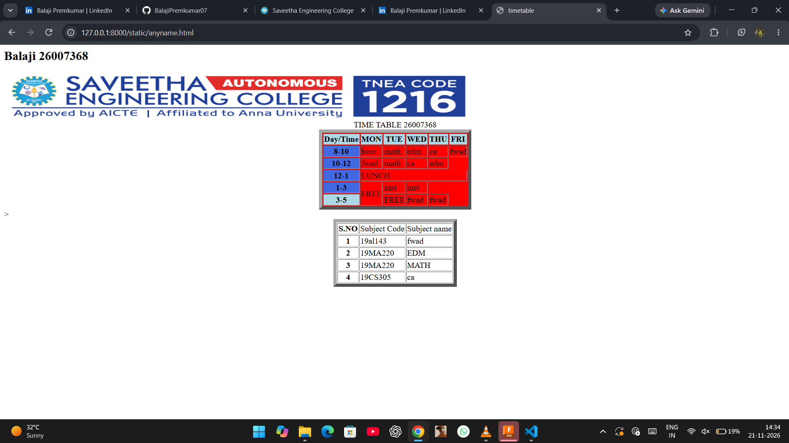

# Ex04 Time Table
## Date: 21-11-2026

## AIM
To write a html webpage page to display your slot timetable.

## ALGORITHM
### STEP 1
Create a Django-admin Interface.

### STEP 2
Create an App inside the Django project.

### STEP 2
Create a static folder uder the created App and insert HTML code.

### STEP 3
Create a simple table using ```<table>``` tag in html with the relevant attributes.

### STEP 4
Add rows using ```<tr>``` tag.

### STEP 5
Add your course schedule using ```<td>``` tag.

### STEP 6
Execute the program using runserver command.

## PROGRAM
```
<html>
    <head>
        <title>timetable</title>
    </head>
    <body>
        <h2>Balaji 26007368</h2>
        
        <table bgcolor="red" border="7px" align="center">
            <caption align="center">TIME TABLE 26007368</caption>
            <tr bgcolor="lightblue">
                <th>Day/Time</th>
                <th>MON</th>
                <th>TUE</th>
                <th>WED</th>
                <th>THU</th>
                <th>FRI</th>
            </tr>
            <tr>
                <th bgcolor="royalblue">8-10</th>
                <td>beee</td>
                <td>math</td>
                <td>edm</td>
                <td>ca</td>
                <td>fwad</td>

            </tr>
            <tr>
                <th bgcolor="royalblue">10-12</th>
                <td>fwad</td>
                <td>math</td>
                <td>ca</td>
                <td>edm</td>
            <tr>
                <th bgcolor="royalblue">12-1</th>
                <td colspan="5">LUNCH</td>
            </tr>
            <tr>
                <th bgcolor="royalblue
                ">1-3</th>
                <td rowspan="2">FREE</td>
                <td>mat</td>
                <td>mat</td>

            </tr>
            <tr>
                <th bgcolor="lightblue">3-5</th>
                <td rowspan="2">FREE </td>
                <td>fwad</td>
                <td>fwad</td>
            </tr>
        </table>
        <table  border="7px" align="center"> >
            <tr>
                <th>S.NO</th>
                <td>Subject Code</td>
                <td>Subject name</td>
            </tr>
             <tr>
                <th>1</th>
                <td>19al143</td>
                <td>fwad</td>
            </tr>
            <tr>
                <th>2</th>
                <td>19MA220</td>
                <td>EDM</td>
            </tr>
              <tr>
                <th>3</th>
                <td>19MA220</td>
                <td>MATH</td>
            </tr>
             <tr>
                <th>4</th>
                <td>19CS305 </td>
                <td>ca</td>
            </tr>


     

        </table>


    </body>
</html>


```
## OUTPUT


## RESULT
The program for creating slot timetable using basic HTML tags is executed successfully.
